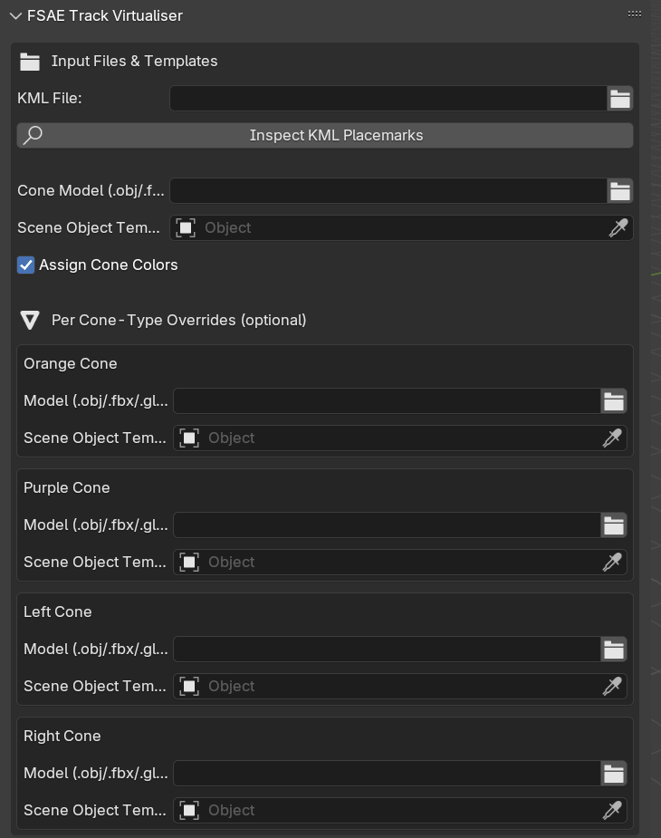
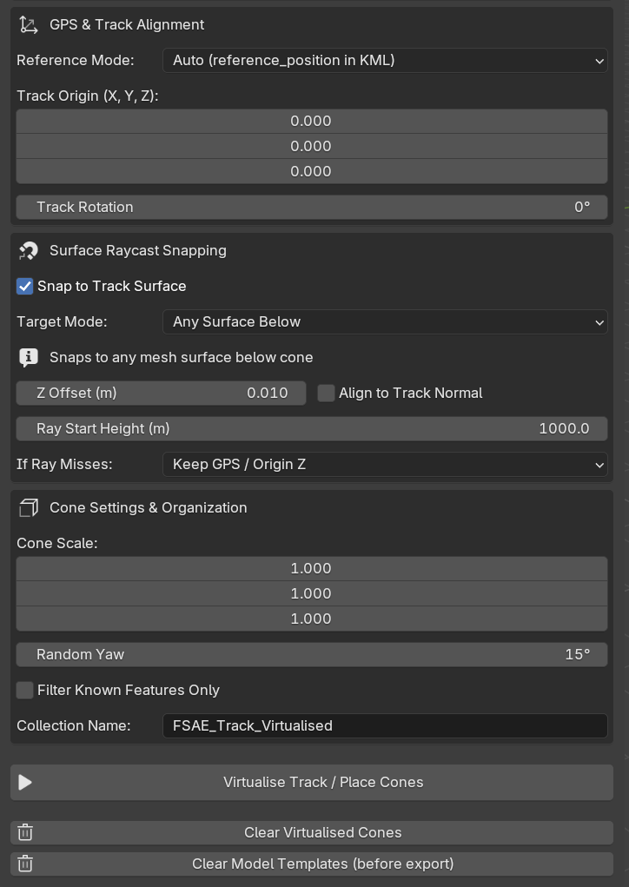

**What is it?**
The **[FSAE_track_virtualiser](https://github.com/cakemun/FSAE_track_virtualiser)** is a Blender plugin that allows for the import and virtualisation of tracks from the .kml files produced by the **[FSAE_track_generator](https://github.com/cakemun/FSAE_track_generator)** and **[FSAE-Track-Mapper](https://github.com/cakemun/FSAE-Track-Mapper)**. The plugin allows for significant customisation of imported track features and data alignment.

**Who is it for?**
Everyone! But mainly teams wishing to generate Formula SAE-style tracks, either from gathered GPS points or virtual track points. Teams can use this tool to assist with driver training and memorisation of the track layout.
### Key features
- Placement of four different cone types on the track: orange, purple, left, and right
- Automatic direction of travel alignment for chicanes
- Use of standardised .kml file for feature import
- Selection of a model for each feature type
- Setting reference alignment by position and rotation
- Adjustment of raycast placement of features
- Scaling of model

## Getting started

1. Install Blender
	*Development was performed on Blender 4.2.*
	
2. Use your external Python installation to install packages into the Blender Python environment:
	```pip install -r requirements.txt -target="[your blender installation path]/BlenderFoundation/Blender/[blender_version]/scripts/modules" --no-user```

	In Blender, you can find your installation path using the following command in the Blender Python console:
	
	```bpy.utils.user_resource("SCRIPTS", path="modules")```
	Note:
	**Ensure that the version of your external Python installation matches that of your Blender Python installation.**

3. Open **Edit -> Preferences -> Get Extensions**.
4. Select **Install from Disk**, then select the `FSAE_track_virtualiser_blender.py` script.
5. Once installed, the plugin's options panel can be found in the main 3D View, in the N-panel (press **N** in the 3D View), under **FSAE Track Virtualiser**.


### Blender Interface




### Add-on workflow

**The tool requires an existing .kn5 file for the track you wish to replicate.**

1. Select a .KML file containing track features
2. Select the cone models you wish to use: orange, purple, right, and left.
3. Select the reference option you wish to use. **Auto** assumes that a reference-point placemarker is present in the selected .kml file. Alternatively, you can select a feature in the .kml file to use as a reference point.
4. Select the **Snap to track surface** option to snap cones to the track surface.
5. Select your desired scaling options.
6. Press **Virtualise track**.
7. Before exiting, press **Clear model templates** to remove the template models.

## Importing a Track (Assetto Corsa)

Importing a track from Assetto Corsa is as easy as downloading the built extension package from the following [GitHub](https://github.com/leBluem/io_import_accsv) page.

Follow the same process described above to install the add-on.

Once the add on is installed, unzip a downloaded track folder.

Go File -> Import -> AC .KN5 and find the .kn5 file of the track.

Your track should now be an imported model in Blender.

## Exporting a Track (Assetto Corsa)

Using the same extension as the importer tool, go to **File -> Export -> AC track**.

Export the .kn5 file to the track folder it was sourced from. The exported .kn5 file must match the track folder's name, so it is recommended that you rename the original track to prevent overwriting it.
